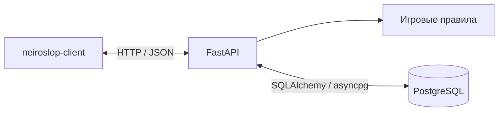

# neiroslop-server

Серверная часть учебного проекта «Виртуальное казино — NEIROSLOP BURMALDA». Приложение на Python и FastAPI предоставляет API для игр с виртуальными монетами. Денежные платежи и вывод средств не предусмотрены.

## Назначение

Сервер управляет гостевыми сессиями, каталогом игр, ставками, выигрышами, бонусами и историей. Он проверяет входные данные и рассчитывает результаты игровых раундов. Клиент не может самостоятельно начислить монеты или изменить итог раунда.

## Архитектура

Обработка раунда, изменение баланса и запись операций выполняются в одной транзакции. Блокировка строки игрока согласует параллельные запросы. Уникальный идентификатор запроса предотвращает повторное списание при повторной отправке.

В опубликованном репозитории пакет `backend/` содержит маршруты API, схемы запросов, игровые сервисы, модели SQLAlchemy и проверки. Определения таблиц находятся в `backend/app/models.py`. PostgreSQL работает отдельным процессом; доступ к нему получает только сервер.

## Связанные компоненты

- [neiroslop-client](https://github.com/dashkalikov/neiroslop-client) — браузерный интерфейс.
- [neiroslop-database](https://github.com/dashkalikov/neiroslop-database) — описание структуры хранения и средства для PostgreSQL.

Текущий прототип создаёт отсутствующие таблицы при старте. Версионируемые миграции и полноценная регистрация пользователей относятся к дальнейшему развитию.

## Совместная работа

Участники предлагают изменения через pull request из рабочих веток в `main`. Для них требуется одобрение другого участника, повторное одобрение после новых коммитов и закрытие обсуждений; прямые push в `main`, force push и удаление ветки запрещены. Владелец личного репозитория может обходить защиту, напрямую отправлять изменения в `main` и сливать pull request без чужого одобрения. Правила применяются в настройках GitHub.

CI/CD будет добавлен отдельным этапом.

Общий обзор проекта: [архитектура](../docs/architecture.ru.md).
