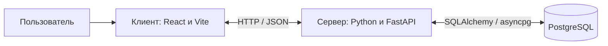

# Виртуальное казино — NEIROSLOP BURMALDA

Учебный веб-проект с игровыми автоматами, виртуальными монетами и тематическим интерфейсом. Пользователь выбирает игру, делает ставку, получает результат раунда и просматривает историю. Монеты не имеют денежной стоимости: покупка, вывод средств и игра на реальные деньги не предусмотрены.

Проект объединяет восемь игровых тем: Saloon Luck, Big Bass Bonanza, Goldrush Canyon, Velvet Sevens, Moonlight Magic, Temple of Gold, Neon Nights и Ocean Myth. Интерфейс поддерживает светлую и тёмную темы, выбор фона, звуковое сопровождение, автоматические вращения и адаптацию к мобильным устройствам.

## Архитектура

Приложение состоит из трёх самостоятельных частей: браузерного клиента, сервера API и базы данных PostgreSQL.

| Компонент | Ответственность |
| --- | --- |
| Клиент | Каталог игр, навигация, анимация, настройки оформления и звука, отображение баланса и результатов |
| Сервер | Гостевые сессии, проверка ставок, игровые правила, расчёт выигрышей, бонусы и история раундов |
| База данных | Хранение игроков, каталога игр, бонусного состояния, раундов и операций с виртуальным балансом |

Клиент отправляет выбранную игру, ставку и уникальный идентификатор запроса. Сервер проверяет запрос, рассчитывает результат и сохраняет изменения одной транзакцией. Клиент показывает полученный результат; итоговый баланс и выигрыш определяет сервер.

Повторный запрос с тем же идентификатором возвращает уже сохранённый результат без повторного списания ставки. Блокировка кошелька на время транзакции защищает баланс при одновременных запросах. Браузер не подключается к PostgreSQL напрямую.

## Организация репозиториев

Проект разделён на три публичных репозитория:

| Репозиторий | Содержимое |
| --- | --- |
| [neiroslop-client](https://github.com/dashkalikov/neiroslop-client) | React-приложение, графика, звук, клиентские проверки и конфигурация Vite |
| [neiroslop-server](https://github.com/dashkalikov/neiroslop-server) | FastAPI-приложение, игровые правила, модели SQLAlchemy и серверные проверки |
| [neiroslop-database](https://github.com/dashkalikov/neiroslop-database) | Описание структуры данных и вспомогательные средства для PostgreSQL |

[Общая доска NEIROSLOP](https://github.com/users/dashkalikov/projects/1/views/1) объединяет задачи и pull request из всех трёх репозиториев. Репозитории размещены в личном аккаунте `dashkalikov`; доступ предоставляется отдельно к каждому репозиторию.

Граница между сервером и базой данных проходит по соединению с PostgreSQL. Сейчас определения таблиц находятся в серверных моделях SQLAlchemy. Репозиторий базы данных описывает структуру хранения и содержит вспомогательные средства; отдельной системы версионируемых миграций пока нет.

## Работа команды

Целевая модель разработки — короткие рабочие ветки `feature/*`, `fix/*`, `docs/*` и pull request в `main`. Для слияния требуется как минимум одно одобрение другого участника с правом записи. После новых коммитов требуется повторное одобрение; обсуждения должны быть закрыты.

Для участников защита `main` запрещает прямые push, принудительную перезапись истории и удаление ветки. Владелец личного репозитория может обходить защиту: напрямую отправлять изменения в `main` и сливать pull request без чужого одобрения, в том числе для срочных исправлений. Управление доступом и настройками остаётся у владельца. Фактические правила задаются в настройках GitHub.

## Текущее состояние

Реализованы гостевые кошельки, серверный расчёт игровых раундов, сохранение истории, ежедневный подарок и игровые бонусы. Проект остаётся учебным прототипом: регистрация пользователей, версионируемые миграции и производственная эксплуатация относятся к дальнейшему развитию.

CI/CD планируется отдельным этапом после настройки репозиториев и процесса совместной работы.

## Saloon Luck

Отдельная игра по присланному эскизу механического автомата: детализированный бронзовый корпус, неоновые стеклянные лампы, три живых барабана, кристальный рычаг, подсветка кнопок, выпуклое стекло барабанов и лоток с монетами. Три кристалла BONUS дают 8 бесплатных вращений с удвоенными линейными выигрышами. Ставка вводится вручную; доступны автоспин, таблица выплат, история и увеличение корпуса. Наклонные кнопки на корпусе дополнены современной панелью справа с общей ставкой и состоянием игры. Удлинённый резной рычаг меняет перспективу при движении и вращает шестерни; лампы, неон и искры анимированы, подсветка плавно исчезает до прозрачности. Сервер сохраняет результаты и баланс в PostgreSQL.

Игра: `http://127.0.0.1:3000/#game/saloon`. [Графика и описание реализации](https://github.com/dashkalikov/neiroslop-client/blob/main/docs/saloon-luck.md).
